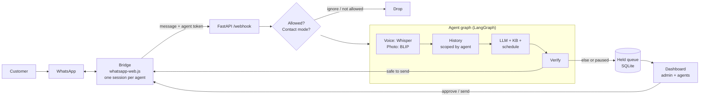

# WhatsApp AI Assistant Agent

**AI customer service for logistics companies on WhatsApp** — multiple agents, one operations dashboard, and human approval when the AI should not guess.

Each agent links their **business WhatsApp** by scanning a **QR code** in the dashboard. Incoming chats get AI-drafted replies grounded in your company notes; sensitive topics (bookings, payments, commitments) go to a **held queue** for a human to approve.

> The goal is not “reply to everything.” It is: **reply like the company would — and hold the rest.**

## Contents

- [What it does](#what-it-does)
- [Roles and flow](#roles-and-flow)
- [How a message is decided](#how-a-message-is-decided)
- [Architecture](#architecture)
- [The dashboard](#the-dashboard)
- [Safety design](#safety-design)
- [Privacy and data flow](#privacy-and-data-flow)
- [Setup](#setup)
- [Configuration](#configuration)
- [Tests and evaluation](#tests-and-evaluation)
- [Project structure](#project-structure)
- [Known limits](#known-limits)
- [More docs](#more-docs)

## What it does

**On WhatsApp (per agent line)**

- Answers customer messages using your **knowledge base** and schedule (`data/kb/`), not invented facts.
- Matches the customer’s language when `REPLY_LANGUAGE=match` (e.g. English, Urdu, Roman Urdu).
- Handles **voice notes** (faster-whisper) and **photos** (BLIP captions); optional **voice replies** on WhatsApp.
- **Auto-sends** when the reply is grounded and safe; **holds** meetings, payments, private details, or anything the model flags as needing a human.
- Optional style retrieval from past chat examples (`data/style_examples.md`).

**In the dashboard** (web UI for admin and agents)

- **Register company** and sign in with **email + password** (admin and agents).
- **Team** — admin adds customer-service agents (each gets their own login).
- **WhatsApp** — each agent opens their tab, shows **QR code**, scans on the phone that owns that business line.
- **Held** — approve, edit, send, or dismiss queued replies with reasons.
- **Messages** — full in/out log (admin sees the org; scoped per agent where applicable).
- **Activity** — audit trail of sends, holds, and setting changes.
- **Chat** — internal assistant (**Mika**) to draft sends, list messages, and voice controls (optional).
- Global **auto-reply** kill switch and per-contact modes (automatic / ask first / ignore).

See [docs/LOGISTICS_MULTI_TENANT.md](docs/LOGISTICS_MULTI_TENANT.md) for the admin + agent workflow in detail.

## Roles and flow

| Role | Responsibilities |
|------|------------------|
| **Company admin** | Register the organization, add agents, monitor all messages, held items, and activity |
| **Agent** | Sign in, link WhatsApp via QR, serve customers on that number with the same AI + voice pipeline |

Typical flow:

1. Admin registers **ABC Logistics** and signs in.
2. **Team** → create agents (name, email, password).
3. Each agent signs in → **WhatsApp** → **Show QR code** → scan on their business phone.
4. Customers message that line → webhook → AI reply or **held** for approval.
5. Admin uses **Messages** / **Held** / **Activity** to oversee the team.

One WhatsApp number per agent session (separate `LocalAuth` data under `whatsapp-bridge/`). Webhook routing uses per-agent bridge tokens in `data/bridge_agents.json` (generated automatically).

## How a message is decided

One model call returns the reply plus two flags. Sending is plain code, not model judgment:

```text
send automatically  =  reply is not empty  AND  grounded  AND  NOT needs_owner
```

| Flag | Meaning |
|------|---------|
| `grounded` | Facts come from the prompt: company notes, schedule, time, or the conversation — not guesses. |
| `needs_owner` | Human-only: decisions, private info, invitations, confirm/pay/commitment language, or complex cases. |

When in doubt, the default is **hold**. Common reasons in the dashboard:

| Reason | Cause |
|--------|--------|
| Needs you to answer | `needs_owner` was true |
| May contain an unverified fact | `grounded` was false |
| No usable model output | Empty or malformed (fails closed) |
| Auto-reply paused | Global kill switch |
| Contact set to ask first | Per-contact mode |

Flags are self-reported; use the [evaluation set](#tests-and-evaluation) to measure real send/hold behavior.

## Architecture



| Part | Role |
|------|------|
| **Bridge** (`whatsapp-bridge/`) | Node layer: multi-agent QR sessions (`BRIDGE_MULTI=true`), forwards messages to the backend with the correct secret. Send API on `127.0.0.1` only. |
| **Agent** (`app/agent_graph.py`, `app/llm.py`) | LangGraph: STT/vision → history → LLM JSON reply → send vs hold. |
| **Backend** (`app/main.py`) | Webhook, allowlist, contact modes, kill switch, message log, agent scoping. |
| **Auth & team** (`app/users.py`, `app/team.py`, `app/auth_context.py`) | Company registration, agent accounts, QR image API for linking. |
| **Dashboard** (`app/dashboard.html`, `dashboard.py`, …) | Login, team, WhatsApp QR, held queue, messages, activity, Mika. |

## The dashboard

| Tab | Purpose |
|-----|---------|
| **Chat** | Internal assistant (Mika): draft messages, list/read messages, voice (optional) |
| **Held** | Replies waiting for approval, with reason — edit, send, or dismiss |
| **Messages** | Received and sent messages by contact and day |
| **Activity** | Audit log |
| **Team** | Admin: add/remove agents |
| **WhatsApp** | Agent: connection status and **QR code** to link a business line |
| **Contacts** | Per-contact mode: automatic, ask first, or ignore |

Header: **Auto-reply**, **Direct send**, voice options. Legacy single-password login still works if no company account exists (`DASHBOARD_PASSWORD` only).

## Safety design

| Risk | Mitigation |
|------|------------|
| Invented company facts | Ground replies in KB and schedule; ungrounded → hold |
| Risky auto-send | `needs_owner` for commitments, money, private data; fail closed on bad JSON |
| Cross-agent data leaks | Messages and history scoped by `agent_id` / org in the database |
| Unauthorized dashboard use | Email/password sessions; signed cookies; lockout; webhook requires bridge token |
| Double send on approve | Held items: atomic `pending → sending → sent` in SQLite |
| Arbitrary sends from UI | Sends tied to stored chat ids; contact names from `contacts.json` where used |

Structured logs avoid storing full message bodies in log lines where possible.

## Privacy and data flow

| Data | Where it goes |
|------|----------------|
| Message text, KB, schedule, recent conversation | **OpenAI API** (reply generation) |
| Voice, photos, optional embeddings | **Local** (faster-whisper, BLIP, sentence-transformers) |
| Held queue, history, audit | **Local SQLite** (`data/assistant.db`) |
| Dashboard TTS | edge-tts (default) or OpenAI if configured |

Restrict who gets auto-replies with **`ALLOWED_CONTACTS`** (empty = all customers; set numbers to limit). Customers are talking to software acting on behalf of the company — use holds for anything sensitive.

## Setup

**Requirements:** Python 3.11+, Node.js 20+, OpenAI API key. Use an HTTPS tunnel (Cloudflare, ngrok) if you open the dashboard from another device (microphone / location).

```bash
# backend
python -m venv venv && source venv/bin/activate   # Windows: venv\Scripts\activate
pip install -r requirements.txt

# bridge
cd whatsapp-bridge && npm install && cd ..
```

Create `.env` in the project root (see [Configuration](#configuration)). Minimum: `OPENAI_API_KEY`, `OPENAI_MODEL`, `DASHBOARD_PASSWORD`, `BRIDGE_API_TOKEN`, and URLs/ports for bridge ↔ backend.

1. **`contacts.json`** (optional): map display names to numbers for dashboard sends — `{"Support": "201012345678"}`.
2. **`data/kb/`**: company facts, services, ETAs, policies. Keep structured sections the agent can cite.
3. **`data/style_examples.md`**: example reply lines for tone (optional).

```bash
# .env: BRIDGE_MULTI=true, BACKEND_URL=http://127.0.0.1:8001/webhook, etc.

uvicorn app.main:app --host 127.0.0.1 --port 8001    # 1. backend
cd whatsapp-bridge && npm start                       # 2. bridge
```

Open `http://127.0.0.1:8001/dashboard` → **Register company** (first time) or sign in → admin adds agents → each agent links **WhatsApp** via QR.

Both backend and bridge must run for live auto-replies on WhatsApp.

## Configuration

Set variables in `.env`. Important ones for logistics multi-agent mode:

| Variable | Purpose |
|----------|---------|
| **`OPENAI_API_KEY`**, **`OPENAI_MODEL`** | Reply generation and dashboard assistant |
| **`DASHBOARD_PASSWORD`** | Legacy dashboard login; also set a strong value before go-live |
| **`BRIDGE_API_TOKEN`** | Legacy single-bridge secret (multi-agent uses per-agent tokens in `data/bridge_agents.json`) |
| **`BRIDGE_MULTI`** | `true` (default in bridge): QR per agent from dashboard |
| `BACKEND_URL`, `BRIDGE_API_URL`, `BRIDGE_API_PORT` | Bridge ↔ FastAPI |
| **`ALLOWED_CONTACTS`** | Comma-separated numbers; empty = all customers |
| `ALLOW_MULTI_ORG` | Allow more than one company registration on one install |
| `USER_NAME` | Persona name when someone sends only a name ping |
| `REPLY_LANGUAGE` | `match` (default), or force a language |
| `REPLY_WITH_VOICE` | Voice replies on WhatsApp for voice notes |
| `TTS_PROVIDER` | `edge` or `openai` |
| `WHISPER_MODEL_SIZE` | STT model size |
| `ALLOW_GROUPS` | Answer group chats (default off) |
| `MESSAGE_RETENTION_DAYS` | Message history retention |
| `STYLE_RETRIEVAL`, `EMBEDDING_MODEL` | Optional tone retrieval |
| `TRUST_PROXY` | `true` behind a reverse proxy / tunnel |

## Tests and evaluation

```bash
pytest -q                          # unit/API tests; ML stubbed
python -m evals.run_eval           # live model checks (~30 cases)
python -m evals.run_eval --runs 3  # stricter pass rule
```

Tests cover webhook auth, allowlist (`@lid`), kill switch, held-item state, login lockout, and parsers. The eval set (`evals/cases.jsonl`) focuses on **unsafe auto-sends** vs appropriate holds.

## Project structure

```text
app/
  main.py              webhook, allowlist, agent scoping
  agent_graph.py       LangGraph pipeline, send vs hold
  llm.py, lang.py      prompts, language matching
  users.py, team.py    org registration, agents, WhatsApp QR API
  auth_context.py      session user (admin vs agent)
  db.py                SQLite: orgs, users, messages, held queue
  dashboard.py         login, sessions, send/transcribe/speak
  dashboard.html       dashboard UI
  assistant.py         Mika (internal ops assistant)
  controls.py, approvals.py
  stt.py, tts.py, vision.py
whatsapp-bridge/
  index.js             multi or legacy WhatsApp client
  session_manager.js   per-agent LocalAuth + QR
  bridge_api.js        local send API
docs/
  LOGISTICS_MULTI_TENANT.md
tests/, evals/
data/                  kb, database, bridge_agents.json (not all committed)
```

**Do not commit:** `.env`, `data/assistant.db`, `contacts.json`, `.wwebjs_auth/`, session caches, `node_modules/`, or raw chat exports. WhatsApp session data grants account access.

## Known limits

- **whatsapp-web.js** is unofficial; numbers can be restricted by Meta. Production at scale should consider the **WhatsApp Business Cloud API**.
- Model safety flags are heuristic; validate with evals and human review on held items.
- Photo understanding is caption-based (BLIP), not full vision in the LLM.
- One linked WhatsApp session per agent; reconnect via dashboard if logged out.
- Wake word / browser voice features need HTTPS and supported browsers.

## More docs

- [Logistics multi-tenant setup](docs/LOGISTICS_MULTI_TENANT.md)
- [LinkedIn / demo narrative](docs/LINKEDIN_PRESENTATION.md) (optional)

## Roadmap

- Stronger deterministic pre-filters (payments, scheduling) before the model
- Per-contact automated-reply disclosure
- Docker / one-command deploy
- Official WhatsApp Cloud API adapter
- Cost limits and alerting on LLM usage
